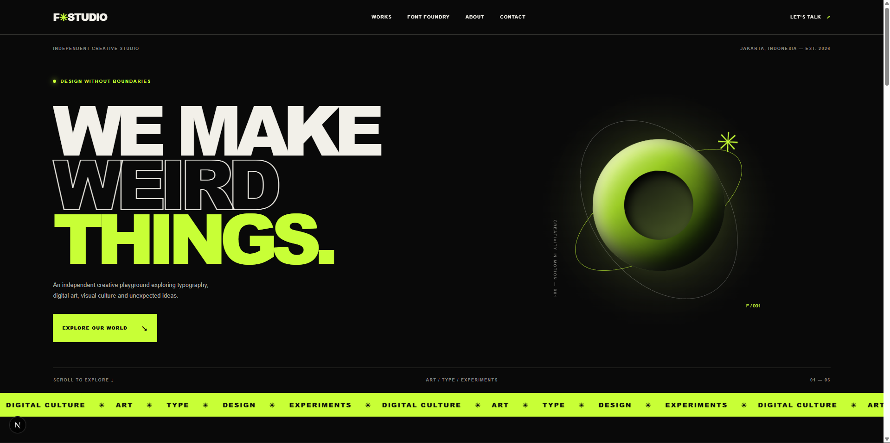

# FUNTASY STUDIO®
### Independent Creative Universe

An independent creative playground exploring experimental typography, digital art, graphic design, and visual experiences.

[](https://nextjs.org/)
[](https://react.dev/)
[](https://www.typescriptlang.org/)
[](https://github.com/adelderderder/Funtasy-Studio)
## Homepage Preview


---

## 1. Project Overview

**FUNTASY STUDIO** is a personal creative universe and digital design platform built to showcase original creative works and develop a space for digital product distribution.

The project combines experimental visual design, typography, and interactive web experiences into one creative destination.

It is designed to become a portfolio and digital marketplace where visitors can explore creative projects, discover original typefaces, and eventually purchase digital assets.

## 2. Vision & Objectives

Our vision is to build an independent creative platform that connects visual experimentation with accessible digital products.

### Key Objectives

- Showcase original typography and font collections.
- Present graphic design, illustration, and digital artwork.
- Build an engaging and interactive portfolio experience.
- Develop a digital font foundry and product catalog.
- Support local and international audiences.
- Establish a foundation for future digital product sales.

## 3. Current Features & Development Status

### Implemented

- [x] Initial Next.js application setup.
- [x] TypeScript configuration.
- [x] Tailwind CSS integration.
- [x] Dark experimental visual direction.
- [x] Responsive homepage structure.
- [x] Navigation and homepage sections.
- [x] Animated visual elements.
- [x] Selected Works section.
- [x] Font Foundry showcase section.
- [x] About and Contact sections.
- [x] Basic SEO metadata.
- [x] ESLint validation.
- [x] TypeScript validation.
- [x] Initial GitHub repository setup.

### Planned

- [ ] Interactive font preview tool.
- [ ] Custom text input and typography controls.
- [ ] Individual font detail pages.
- [ ] Original font file integration (OTF/TTF).
- [ ] Artwork and project detail pages.
- [ ] Digital product purchasing system.
- [ ] Payment integration for Indonesian and international customers.
- [ ] Product licensing and download delivery.
- [ ] SEO optimization and performance improvements.
- [ ] Deployment to a public production domain.

## 4. Technology Stack

| Technology | Purpose |
|---|---|
| Next.js 16 | React framework and application architecture |
| React 19 | User interface development |
| TypeScript | Type-safe application development |
| Tailwind CSS | Styling foundation |
| CSS | Custom styling and animations |
| ESLint | Code quality and linting |
| Git & GitHub | Version control and collaboration |

## 5. Design Direction

The current visual identity follows a **Dark + Experimental** art direction.

Key visual principles:

- Dark backgrounds and high-contrast typography.
- Lime accent colors.
- Oversized experimental typography.
- Asymmetric editorial layouts.
- Abstract visual compositions.
- Motion and animation.
- Responsive layouts for different screen sizes.

The design aims to create a distinctive experience inspired by contemporary digital portfolios and experimental creative websites.

## 6. Getting Started

### Prerequisites

Make sure you have installed:

- Node.js (LTS recommended)
- npm
- Git

### Installation

Clone the repository:

```bash
git clone https://github.com/adelderderder/Funtasy-Studio.git
```

Navigate to the project directory:

```bash
cd Funtasy-Studio
```

Install dependencies:

```bash
npm install
```

Start the development server:

```bash
npm run dev
```

Open your browser:

```text
http://localhost:3000
```

### Code Validation

Run ESLint:

```bash
npm run lint
```

Run TypeScript validation:

```bash
npx tsc --noEmit
```

## 7. Project Structure

```text
Funtasy-Studio/
├── public/
│   └── Static assets
├── src/
│   └── app/
│       ├── favicon.ico
│       ├── globals.css
│       ├── layout.tsx
│       └── page.tsx
├── .gitignore
├── AGENTS.md
├── eslint.config.mjs
├── next.config.ts
├── package.json
├── package-lock.json
├── README.md
└── tsconfig.json
```

## 8. Development Roadmap

| Phase | Focus | Status |
|---|---|---|
| Phase 1 | Project foundation and setup | Completed |
| Phase 2 | Homepage and visual identity | Completed |
| Phase 3 | Interactive font foundry | Planned |
| Phase 4 | Artwork portfolio and detail pages | Planned |
| Phase 5 | Digital product marketplace | Planned |
| Phase 6 | Payment and delivery integration | Planned |
| Phase 7 | Testing, optimization, and deployment | Planned |

## 9. Project Status

**Current Stage: Foundation & Homepage Development Completed**

The initial application foundation and primary homepage experience are implemented.

The project is currently moving toward its interactive typography experience and digital product platform.

This repository is actively developed, and features may evolve as the project progresses.

## 10. Repository

GitHub: https://github.com/adelderderder/Funtasy-Studio

Branch: `main`

---

**FUNTASY STUDIO®**

*Independent by nature. Creative by default.*